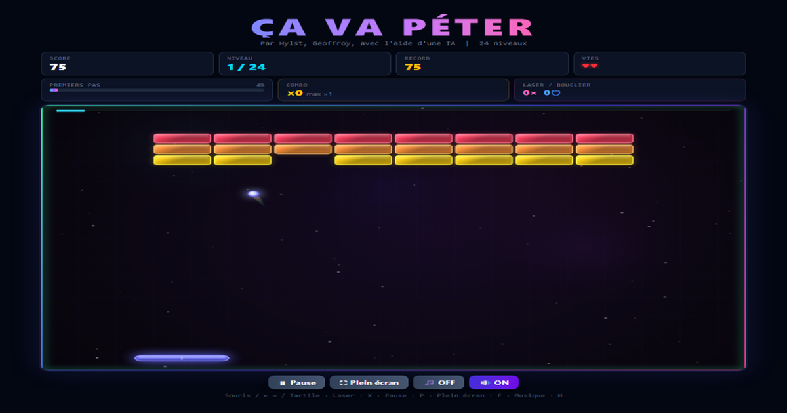

# Ça Va Péter

**Casse-briques arcade, 24 niveaux, 11 power-ups.**

Joue ici : [games.hylst.fr/cavapeter/](https://games.hylst.fr/cavapeter/)



## Comment on joue

Le casse-briques classique : une balle rebondit entre ta raquette et un mur de briques.
Détruis toutes les briques pour passer au niveau suivant. Rate la balle trop de fois et
c'est game over.

24 niveaux avec des motifs de briques différents (damier, pyramide, diamant, forteresse,
cœur, hexagone...), une difficulté qui monte progressivement, des briques blindées à partir
du niveau 13, et des power-ups qui pleuvent en cours de route.

## Contrôles

| Action | Effet |
|--------|-------|
| Souris | Déplace la raquette |
| ← / → ou A / D | Déplace la raquette au clavier |
| X | Tire au laser (si le power-up est actif) |
| P ou Échap | Pause |
| F | Plein écran |
| M | Musique |
| Clic sur le plateau | Démarrer / niveau suivant / rejouer selon l'état |

Fonctionne aussi au tactile.

## Les 11 power-ups

| Power-up | Effet |
|----------|-------|
| ↔ Élargir | Raquette plus large |
| ↕ Rétrécir | Raquette plus étroite (piège) |
| ●● Multi-Balle | Deux balles supplémentaires |
| ❄ Ralenti | La balle ralentit |
| ⚡ Rapide | La balle accélère (piège) |
| ♥ +1 Vie | Une vie de plus |
| ✦ Boule Feu | Traverse les briques sans rebondir |
| ◉ Aimant | Attire légèrement la balle vers la raquette |
| ▬ Bouclier | Absorbe les balles perdues (jusqu'à 8 fois) |
| \| Laser | Tire au clavier (touche X) |
| ✸ Bombe | Explosion en chaîne sur les briques proches |

## Ce qu'il y a dedans

- 24 niveaux, 4 paliers de difficulté (facile, moyen, difficile, expert)
- Système de combo qui multiplie les points sur les enchaînements
- Musique adaptative générée à la volée, qui accélère avec le niveau
- Particules, ondes de choc, tremblements d'écran, traînées lumineuses
- Record personnel sauvegardé en local

## L'arborescence

```
ca-va-peter-game-development/
├── index.html          # template + bloc SEO
├── vite.config.ts      # base '/cavapeter/' + singlefile
├── public/
│   ├── favicon.png
│   ├── og-image.png / og-image.webp
│   └── icon.webp         # carte du menu, 128x128
└── src/
    ├── main.tsx
    ├── App.tsx            # HUD, entrées, boucle de rendu
    └── game/
        ├── types.ts        # Ball, Paddle, Brick, GameState...
        ├── constants.ts     # config + les 24 definitions de niveaux
        ├── engine.ts        # tick() : toute la logique de jeu, pure
        ├── renderer.ts       # dessin canvas
        ├── animations.ts     # helpers couleur / formes, sans logique de jeu
        └── audio.ts          # synthese Web Audio (SFX + musique via Howler)
```

## Dev

```bash
npm install
npm run dev       # http://localhost:5173/cavapeter/
npm run build     # dist/index.html, un seul fichier
npm run preview
```

## Stack

React 19, TypeScript 5.9 (strict), Tailwind CSS 4, Vite 7, vite-plugin-singlefile, Howler.js.

Zéro backend, zéro fichier son externe (tout est synthétisé au vol). Le jeu tient dans un
seul fichier HTML et tourne hors ligne.

## Licence

AGPL-3.0-or-later, Geoffroy Streit (Hylst). Voir `LICENSE`.
